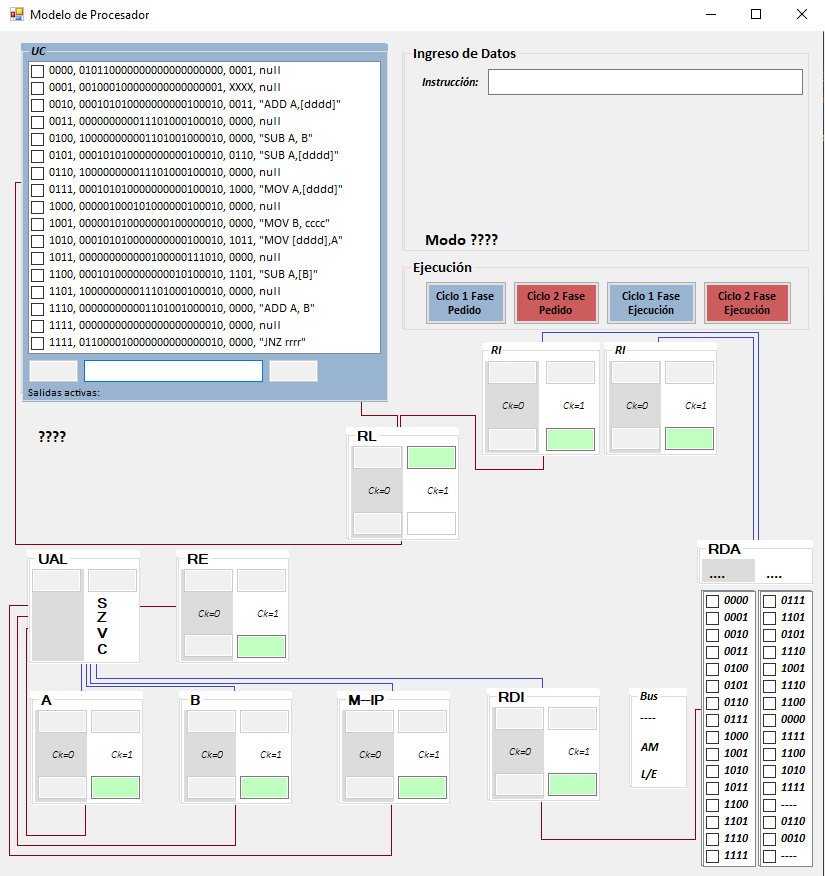

<p align="center">
  
</p>

<p align="center">
  
  
  
</p>

> Trabajo práctico de la **UAI**. Un procesador de 4 bits que se ejecuta paso a paso, para ver qué registro cambia en cada pulso de reloj.

## Qué es

Aplicación de escritorio (Windows Forms) que modela un procesador didáctico. Cada componente (registros, UAL, bus de memoria y unidad de control) se muestra en pantalla con sus valores en `Ck=0` y `Ck=1`. Avanzas con cuatro botones, un ciclo por vez, y ves cómo se busca y ejecuta cada instrucción.

<p align="center"></p>

## Cómo funciona

Cada instrucción tiene dos fases de dos ciclos. Los botones de la interfaz avanzan exactamente esos cuatro pasos.


| Botón | Qué hace |
|---|---|
| Ciclo 1 Fase Pedido | Primer ciclo de la búsqueda de la instrucción |
| Ciclo 2 Fase Pedido | Segundo ciclo de la búsqueda |
| Ciclo 1 Fase Ejecución | Primer ciclo de la ejecución |
| Ciclo 2 Fase Ejecución | Segundo ciclo de la ejecución |

**Componentes modelados** (carpeta `ModeloProcesador/Models`):

| Componente | Función |
|---|---|
| `A`, `B` | Registros de datos |
| `IP` | Puntero de instrucción, con multiplexor `M` (se incrementa en 2 o toma la salida de la UAL) |
| `RI` (izq. y der.) | Registro de instrucción |
| `UAL` | Suma y resta de 4 bits, con flags `SZVC` (signo, cero, desborde, acarreo) |
| `RE` | Registro de estado: guarda los flags |
| `RL`, `RDI` | Registros auxiliares de la interfaz con memoria |
| `BusDir_Memoria` | Bus de direcciones y datos de memoria (`RDA1`, `RDA2`, `AM`, `L/E`) |

Cada componente hereda de `_0FlipFlopBase`, que reproduce el comportamiento de un flip-flop según la fase y el nivel del reloj. La unidad de control es una tabla de 16 microinstrucciones de 24 bits (`InstruccionSetList.DireccionesDelModelo`).

## Instrucciones soportadas

| Instrucción | Modo de direccionamiento |
|---|---|
| `ADD A,B` / `SUB A,B` | Registro |
| `ADD A,[dddd]` / `SUB A,[dddd]` | Directo |
| `MOV A,[dddd]` / `MOV [dddd],A` | Directo |
| `MOV B,cccc` | Inmediato |
| `SUB A,[B]` | Indirecto / indexado |
| `JNZ rrrr` | Relativo |

`dddd`, `cccc` y `rrrr` son valores de 4 bits en binario.

> [!WARNING]
> Según el historial de commits, el simulador está probado en direccionamiento **directo y relativo**. Los demás modos no se probaron.

## Programa de ejemplo

El proyecto trae precargado un programa de 16 posiciones (`InstruccionSetList.ProgramaAEjecutar`):

```asm
0000  MOV A,[1101]   ; A ← memoria[1101]
0010  SUB A,[1110]   ; A ← A − memoria[1110]
0100  MOV B,1110     ; B ← 1110
0110  SUB A,[B]      ; A ← A − memoria[B]
1000  JNZ 0110       ; mientras A ≠ 0, vuelve a 0110
1010  MOV [1111],A   ; guarda el resultado
```

## Ejecutarlo

Necesitas Windows, Visual Studio 2017 o posterior y .NET Framework 4.8.

1. Clona el repositorio y abre `ModeloProcesador.sln` en Visual Studio.
2. Presiona **F5** para compilar y ejecutar.
3. Ingresa una instrucción en el campo **Instrucción** y avanza con los botones de ciclo.


